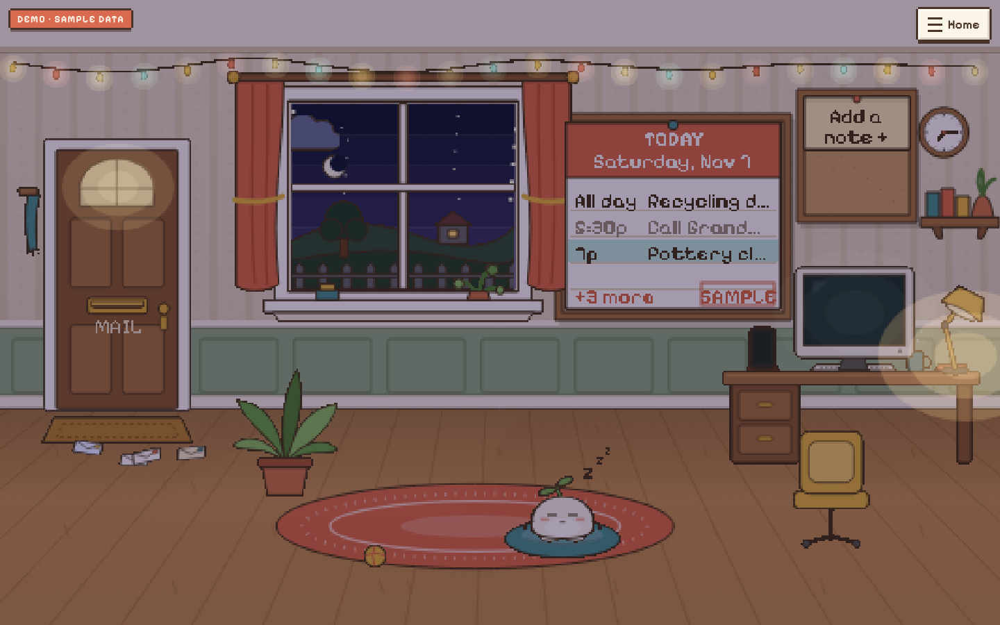

# Living Space

A cozy, retro pixel-art, Tamagotchi-style home that turns your real day into events in an animated room.
Letters arrive at the door (Gmail), today's plans hang on the board (Google Calendar), the window shows your real sky (Open-Meteo), and devices on the desk light up when connected services report activity. A small resident, **Pip**, lives there and goes about its day.

The whole app *is* the room. There are no dashboard cards: every piece of information lives in an object you can click.



## Run it

```bash
cd living-space
npm install
cp .env.example .env.local      # optional; the room runs without it
npm run dev                     # http://localhost:3000
```

Production: `npm run build && npm start`. Tests: `npm test`. Typecheck: `npm run typecheck`.

On first launch you can pick **“Set up my real day”** (live mode) or **“Look around with sample data”** (demo mode). Switch any time under **Home → Mode**.

## Download it: a single HTML file or a desktop app / screensaver

### `living-space.html`: the whole room in one file
`npm run build:html` writes `dist/living-space.html`, about 0.5 MB with the code, styles and pixel fonts inlined. Double-click it to open it in any browser; it works offline.
- Pip, sticky notes, demo mode and **real weather** all work. The file calls Open-Meteo directly, so no server is needed.
- Gmail and Google Calendar **need the hosted version**, because the Google sign-in has to live on a server. The offline copy says so plainly and never shows fake mail.
- The ⛶ button (top right) goes fullscreen **and keeps the screen awake**, so a spare monitor or tablet can show the room all day.
- Add `?screensaver` to the address for a menu-free ambient room.

### Desktop app: menu-bar / tray app with screensaver and live wallpaper (`desktop/`)
Living Space runs in your menu bar (macOS) or system tray (Windows/Linux). Closing the window keeps it running. From the tray menu you can:

| | |
|---|---|
| **Screensaver after idle** | After 1–60 minutes without keyboard or mouse input (default 5), the room fades in fullscreen on **every display**. Any key, click or mouse movement dismisses it. *Keep screen awake while showing* stops the display from sleeping; *Pause for 1 hour* is for movies and presentations. |
| **Show screensaver now** | Start it straight away. |
| **Live wallpaper** | The room sits on your desktop behind all windows (macOS and Linux; Windows doesn't let apps do this). |
| **Windows screen saver** | The installer also puts **`Living Space.scr`** in the install folder. Right-click it → **Install** to pick Living Space in Windows' Screen Saver settings. It handles `/s` and `/c`. |
| **Start at login** | Starts hidden in the tray, ready to show the screensaver. |
| **Room source** | **Built-in (offline)** is the HTML room above. **My hosted Living Space** loads your deployed site, with real Gmail and Calendar. |
| **Link Google account…** | Google doesn't allow sign-in inside desktop apps' built-in browsers. Instead: connect Google on your website → **Home → Connections → Link the desktop app…** → copy the code → paste it here. The code is the site's *encrypted* session cookie (no readable token inside). Treat it like a password. Disconnecting Google on the site revokes every linked copy. |

You may still want to set the OS's own screensaver/sleep timer *longer* than Living Space's, so the system doesn't take over first.

**Getting the installers:** every push that touches `living-space/` runs **Actions → “Living Space downloads”**. The run's *Artifacts* section has:
- macOS `.dmg` (universal)
- the Windows installer and portable `.exe`
- the Linux `.AppImage`
- `living-space.html`

Pushing a tag `living-space-v1.0.0` publishes them on a GitHub Release.

The builds are **unsigned** (no Apple or Microsoft certificates):
- **macOS:** right-click the app → **Open** the first time. On macOS 15 and later: System Settings → Privacy & Security → **Open Anyway**.
- **Windows:** SmartScreen → **More info → Run anyway**.

**Build locally:**

```bash
cd living-space
npm install && npm run build:html          # dist/living-space.html
cd desktop && npm install
npm start                                  # run the app
npm run dist:mac | dist:win | dist:linux   # installers in desktop/release/
```

## Put it on your phone

Living Space installs from your browser as an app (a PWA). It gets a home-screen icon, opens full-screen with no browser bars, and works offline. There's no app store; the phone only needs to reach it at an **https://** address.

### 1. Deploy it (free, about 5 minutes, Vercel)

1. Sign in at [vercel.com](https://vercel.com) with GitHub → **Add New → Project** → import `tresterlingiii`.
2. Set **Root Directory** to `living-space`. The framework is detected as Next.js.
3. Under **Environment Variables**, add at least:
   - `SESSION_SECRET`: 32+ random characters (`node -e "console.log(require('crypto').randomBytes(32).toString('base64url'))"`)
   - `APP_URL`: your Vercel address, e.g. `https://living-space-yourname.vercel.app` (you can fill this in after the first deploy and redeploy)
4. **Deploy.** Open the URL; the room works in demo mode and with weather straight away.
5. Optional:
   - **Gmail + Calendar:** add `GOOGLE_CLIENT_ID` and `GOOGLE_CLIENT_SECRET` (see “Connecting Google”). Add `${APP_URL}/api/auth/google/callback` as the redirect URI.
   - **Shortcut alerts:** add `ALERTS_INGEST_TOKEN`, then **Storage → Upstash for Redis → Connect** to the project. The `KV_REST_API_*` variables are picked up automatically; serverless hosts have no writable disk, so alerts stay off until storage exists.
   - Set `APP_OWNER_EMAIL` so only your Google account can sign in.

### 2. Install

- **iPhone (Safari):** open your URL → **Share** → **Add to Home Screen** → **Add**.
- **Android (Chrome):** open your URL → **Install app** (or menu ⋮ → *Install app*).
- **From a computer:** open **Home → Put it on your phone** in the room. It shows a QR code to scan, plus the right steps for whatever device you're on.

Long-pressing the installed icon offers shortcuts to **Today's plans** and **Mail**.

## Modes

| | Demo | Live |
|---|---|---|
| Mail, calendar, weather | Realistic sample data. Every panel shows a **SAMPLE DATA** stamp, the corner shows **Demo · sample data**, and the board sheet carries a SAMPLE stamp. | Only real data from connected services. If something isn't connected, the room says so and offers to connect. **Nothing is ever substituted.** |
| Dev tools (wrench, top right) | Deliver mail, set unread count, empty or sample calendar, event in 5 min, computer/phone events | Time-of-day and weather *scene* overrides only (data buttons are disabled) |

The dev tools appear in `npm run dev`, or in production when `NEXT_PUBLIC_ENABLE_DEVTOOLS=true`.

## Connecting Google (Gmail + Calendar)

1. In Google Cloud Console, create a project and enable the **Gmail API** and **Google Calendar API**.
2. Configure the OAuth consent screen. While it is in testing, add yourself as a test user.
3. Create an **OAuth client ID → Web application** with this authorised redirect URI: `${APP_URL}/api/auth/google/callback`
4. Fill in `.env.local`: `APP_URL`, `SESSION_SECRET` (32+ random chars), `GOOGLE_CLIENT_ID`, `GOOGLE_CLIENT_SECRET`. Optional: `APP_OWNER_EMAIL` to lock the app to your account.
5. Restart, then go to **Home → Connections → Connect**.

**Scopes requested (minimum):** `openid email`, `gmail.readonly`, `calendar.events.readonly`.
Set `GOOGLE_ALLOW_MARK_READ=true` to request `gmail.modify` instead. The inbox then shows an explicit **Mark as read** button. Nothing is ever marked read automatically.

**Security:**
- OAuth uses the authorization-code flow with PKCE and a signed `state`.
- Access and refresh tokens are kept in an AES-256-GCM encrypted, `httpOnly`, `SameSite=Lax` cookie. Client JavaScript never sees them, and they are never stored in a database.
- All Google calls happen in server route handlers.
- Gmail and Calendar content is never written to `localStorage` or the service-worker cache.
- Disconnecting revokes the grant at Google.

**Behaviour:**
- **Mail** polls every 60 s, pauses while the tab is hidden or offline, and backs off on errors and 429s. The unread count comes from the INBOX label. The newest 20 unread messages are listed.
- **New-delivery detection** uses stable Gmail message ids plus an `internalDate` high-water mark. The first sync is treated as backlog (no animation), and an old email re-marked unread doesn't count as a delivery. See `src/domain/mail.ts` and its tests.
- **Calendar** fetches *today* only, using the local-day window the browser computes. That keeps DST days (23 h / 25 h) correct. It also sends your IANA zone, so all-day events land on the right date. It re-fetches when the date or the time zone changes, and refreshes every 5 min. Events are marked *Ended* by time only; it never claims you did them.

## Weather

[Open-Meteo](https://open-meteo.com) needs no key. Pick a city under **Home → Location**, or press **Use my location**, which asks the browser once. Coordinates are rounded to about 1 km and no precise position is stored. The server proxies and caches responses for 10 minutes, the client refreshes every 15 minutes, and the last forecast is kept for offline use.

## Phone alerts (Apple Shortcuts & automations)

A web page **cannot** read iPhone notifications, iMessages or calls, and this app doesn't pretend to. Instead the phone shows:
- app-generated reminders (sticky notes due today, calendar events starting within 10 minutes)
- alerts **you** push from a Shortcut or automation

Setup:
1. Set `ALERTS_INGEST_TOKEN` (24+ random chars) and `SESSION_SECRET`.
2. In a Shortcut, add **Get Contents of URL**:
   - `POST {APP_URL}/api/alerts`
   - Header `Authorization: Bearer <token>`
   - JSON body `{ "title": "…", "body": "…", "url": "https://…", "source": "Shortcuts" }`
3. In the room, open the phone and enter the token once to **pair** that browser. The browser gets an encrypted, httpOnly pairing cookie. The token is not kept in the browser, and rotating it unpairs every device.

Ingest is rate-limited and validated. Alerts are stored by `src/lib/server/alerts-store.ts` as a JSON file in `DATA_DIR`.

## Architecture

```
src/
  domain/          Pure, tested logic: lighting curve, WMO→scene weather, mail tiers & arrival diff,
                   calendar ordering/status, pet vitals, Open-Meteo normalisation.
  engine/          Client "environment controller"
    store.ts         one typed external store (useSyncExternalStore); persists only durable slices
    clock.ts         20 s clock + sceneLook() = time + weather → lighting
    poll.ts          visibility/online-aware polling with backoff; typed API errors
    character.ts     the resident's brain: behaviour state machine, walking (rAF only while moving)
    adapters/        event-adapter architecture (gmail, calendar, weather, alerts, tasks, demo)
    boot.ts          picks adapters for the mode, wires online/offline + OAuth return
  scene/           Rendering: layered SVG world (1600×900 stage), depth-sorted props, the resident sprite,
                   window weather, camera (fit on desktop, pan on portrait phones), hotspots
  ui/              In-world panels (letter, paper agenda, postcard, monitor, phone, sticky note…), HUD, toasts
  lib/server/      Server-only: env, sealed cookies, Google OAuth/Gmail/Calendar, weather proxy, alert store
  app/api/         Route handlers
```

**Rendering: a real pixel grid.** Every prop is authored as a small vector SVG component (`src/scene/*.tsx`), but nothing is shown as vector. `src/scene/pixel/` rasterises each prop into a sprite at **one pixel per 3 world units** and composites the sprites onto a single 1001×630 canvas. The canvas is then scaled up with `image-rendering: pixelated`, so the whole room, Pip and the weather share one chunky pixel grid on every browser, including iOS Safari (no SVG-filter tricks).
- **Sprites** are cached by their inputs: theme, unread count, Pip's pose and frame, and so on. Only something that changes is re-rasterised.
- **Animation** steps at a handheld-style 12 fps: Pip's walk cycle, blinking, the zzz, rain, snow, lightning, clouds, steam and dust. Movement redraws every frame while Pip walks, and reduced motion drops to about 2 fps with no particles.
- **Text** in the room (planner sheet, notes, MAIL, badges) is drawn in Pixelify Sans at 11 px, the size at which the font lands exactly on the pixel grid. The anti-aliasing is then thresholded away so letters are hard pixels.
- **Light** is posterised: the sky is drawn in flat bands, and the lamp, monitor and fairy-light glows are stepped rings, not smooth gradients.
- Each interactive object is still a real `<button>` over the canvas, so keyboard, screen readers and focus work as before. A focused or hovered object gets blinking pixel corner brackets.

The menus follow the same rules: square notched pixel frames instead of rounded corners, hard drop shadows, a dithered backdrop, stepped animations, Pixelify Sans everywhere, and VT323 on the computer screen. The home-screen icon is pixel art too (`npm run icons`). Rasterising the art in the browser adds `react-dom/server` to the client bundle (about 184 kB first load).

**Adding a source.** Implement `SourceAdapter` (`src/engine/adapters/types.ts`). Write your own store slice, and/or call `pushActivity()` with `channel: "computer" | "phone"`. Then register the adapter in `boot.ts`. The computer lists exactly the adapters that are running, so it never claims sources that aren't integrated.

**Customisation seam.** `src/scene/theme.ts` (`RoomTheme`) drives wall, floor, rug and cushion colours, the resident's colours, the decoration list and a season field. Four room palettes and four resident colours are already selectable. Furniture variants and seasonal themes only need new data and props.

## Accessibility & motion

- Every object is a focusable button with a live label (for example “Mail: 4 unread”).
- Panels are dialogs with a focus trap. Escape closes them and focus returns to the object.
- Touch targets are at least 44 px. Safe-area insets are respected.
- `prefers-reduced-motion` stops the ambient loops. The resident glides between spots instead of walking, and lightning is off.

## Testing done

These ran in this environment:
- **Unit tests** (`npm test`, 23 tests): pile tiers, arrival diffing, calendar ordering/status, DST day bounds and zone midnights, lighting continuity, WMO mapping, Open-Meteo parsing, pet vitals, hotspot non-overlap, camera, cookie sealing.
- **API checks** (curl against a production build): OAuth redirect parameters, `state` mismatch rejection, `not_connected` / `not_configured` errors, alert ingest auth, pairing, read-after-pair, and the 502 path when weather is unreachable.
- **Playwright on a production build:**
  - desktop 1440×900
  - iPhone 13 portrait and landscape: tap, zone panning, panels
  - keyboard: Tab to an object, Enter opens it, Escape returns focus
  - every panel, mail delivery and the 30-letter pile
  - all weather scenes and day/night
  - a task survives a reload
  - an end-to-end Shortcut alert reaches the phone
  - offline reload served by the service worker
  - reduced motion

**Not verifiable here:** a real Google sign-in (needs your OAuth client) and live Open-Meteo responses (this sandbox's network blocks the host; parsing is unit-tested against the documented response shape).

## Limitations

- The desktop builds aren't code-signed (that needs paid Apple/Microsoft developer certificates), so each OS warns on first launch.
- macOS has no API for a third-party app to register as a true system screensaver (`.saver`), so Living Space uses its own idle timer; on Windows the `.scr` is a real screen saver.

- Shortcut alerts are stored in Redis when `UPSTASH_REDIS_REST_*` / `KV_REST_API_*` is set (needed on Vercel), otherwise in a JSON file in `DATA_DIR` (self-hosting).
- Gmail is polled, not pushed. Gmail push via Pub/Sub would give instant delivery but needs a public webhook and a GCP topic.
- Tasks, pet and settings are saved per device in `localStorage`; there's no cross-device sync yet.
- The art is a cohesive hand-built set rasterised to pixels (see `DESIGN.md`), not hand-placed pixel art from an artist. The scene components are the asset pipeline: swap any prop's SVG, or drop in a hand-drawn PNG sprite, keeping its footprint in `layout.ts`.
- iPhone layouts were tested with Playwright's iPhone 13 profile in Chromium, not real Safari. Check on a device before relying on it.
